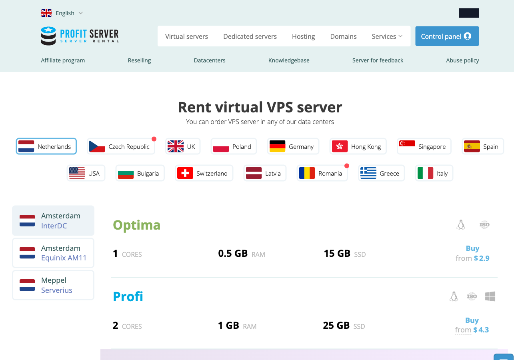
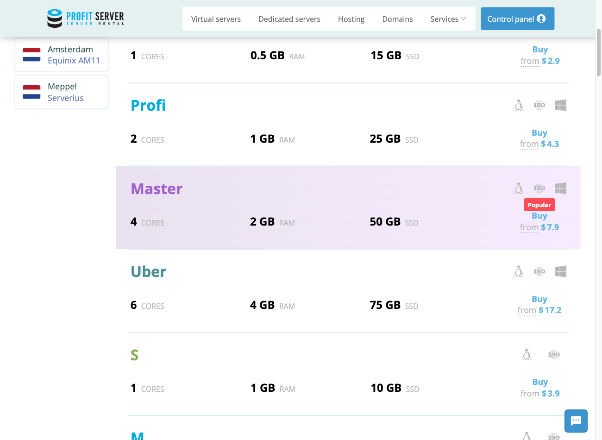
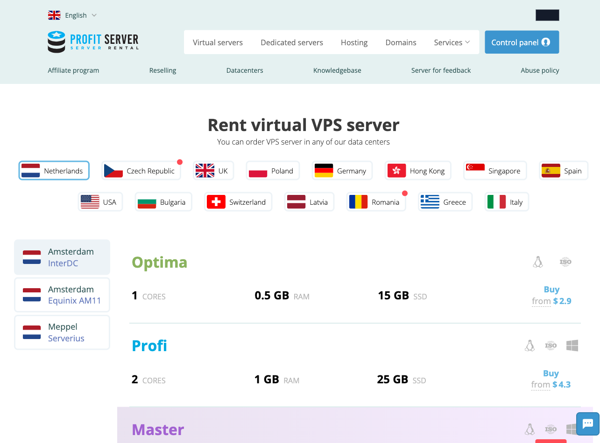

# ProfitServer Review 2026: Low-Cost VPS in Multiple Global Locations

ProfitServer is worth considering when server location matters as much as price. Instead of presenting one generic VPS region, its public catalog lets buyers compare plans across locations including the Netherlands, the United States, Germany, the United Kingdom, Hong Kong, Singapore and other markets.

[Explore ProfitServer VPS locations and plans](https://profitserver.net/?partner_id=3430198)

## Quick verdict

**ProfitServer fits location-specific, self-managed workloads:** regional websites, remote development, monitoring nodes, test environments, small business services and independent workers close to a target audience.

The catalog shows entry configurations such as:

- Optima: 1 CPU, 0.5 GB RAM and 15 GB SSD, displayed from $2.9;
- Profi: 2 CPU, 1 GB RAM and 25 GB SSD, displayed from $4.3;
- Master: 4 CPU, 2 GB RAM and 50 GB SSD, displayed from $7.9;
- larger plans for workloads that need more memory and storage.

The important purchasing advantage is not simply the lowest displayed figure. It is the ability to start with the **country, city or datacenter needed by the workload**, then select an appropriate plan.

## ProfitServer vs DigitalOcean, Vultr and Hetzner

DigitalOcean and Vultr are strong choices when a familiar developer cloud, hourly lifecycle and broad API ecosystem matter. Hetzner is often considered for European infrastructure. ProfitServer competes from a different angle: a wide location catalog paired with conventional VPS plans.

| Priority | Better direction |
|---|---|
| Full developer cloud ecosystem and rapid hourly lifecycle | DigitalOcean / Vultr-style cloud |
| A specific European or international server location | ProfitServer |
| One self-managed regional worker or website | ProfitServer |
| Managed application platform | Managed hosting or PaaS |

ProfitServer is most compelling when “where should the server run?” is the first question. For a regional site or worker, choosing the correct location can be more useful than buying a larger plan in the wrong market.

## Choose location before configuration

The public page groups VPS options by location and displays the available plan set for the selected datacenter. This makes the buying path straightforward:

1. identify where the users, APIs or services are located;
2. select the closest practical ProfitServer region;
3. compare CPU, RAM, SSD and the displayed order total;
4. start with the smallest plan that comfortably fits the application;
5. deploy, monitor and resize only when the workload proves it needs more.

A European website may start with a Netherlands or Germany location. An Asia-facing worker can compare Hong Kong or Singapore availability. A US-facing service can start with a United States location. The best region depends on the actual traffic and connected services.

## Which ProfitServer plan should you choose?

### Optima — lightweight entry workload

The displayed Optima configuration is suitable for a very small static site, monitoring agent, command-line worker or Linux lab. With 0.5 GB RAM, it should remain a deliberately lightweight deployment.

### Profi — small website or service

The displayed Profi configuration provides 1 GB RAM and 25 GB SSD. It is a more realistic starting point for a small website, VPN endpoint, bot or simple API.

### Master — more room for applications

The displayed Master configuration provides 2 GB RAM and 50 GB SSD. It is better positioned for WordPress, a small database-backed service, multiple processes or a modest Docker setup.

[Compare ProfitServer VPS plans](https://profitserver.net/?partner_id=3430198)

## Good use cases

ProfitServer is a practical option for:

- a regional website placed close to its audience;
- a remote development or staging server;
- an uptime, monitoring or automation node;
- a small API, bot or background worker;
- a secondary server in another country;
- a self-managed VPN or private network endpoint.

These are conventional self-managed VPS use cases. The buyer remains responsible for operating-system updates, access control, application deployment and backups.

## Setup path for a first server

After selecting the location and plan, choose a familiar Linux distribution such as Ubuntu or Debian. Then:

1. add an SSH key and disable unnecessary password access;
2. create a non-root administrator;
3. update system packages;
4. configure a firewall;
5. install Nginx, Docker or the required application stack;
6. create an external backup before the server becomes important.

This workflow keeps the server portable. If the project later needs another region or more resources, the application can be recreated rather than locked to one machine.

## Who should choose ProfitServer?

Choose ProfitServer if you want several geographic options in one VPS catalog and can manage the server yourself. Pick a larger developer cloud if the project depends on managed databases, advanced load balancing or a broad set of cloud-native services. Pick managed hosting if you do not want responsibility for Linux administration.

## Final recommendation

ProfitServer's strongest selling point is **location choice at a low entry price**. Start with the region required by the workload, then select Profi or Master for a general-purpose small server. Optima is best reserved for genuinely lightweight tasks.

[Check current ProfitServer locations and VPS availability](https://profitserver.net/?partner_id=3430198)

## FAQ

### Is ProfitServer suitable for a small website?

Yes. A 1 GB or 2 GB plan is a more practical starting point than the smallest 0.5 GB configuration for a dynamic website.

### Which ProfitServer location should I choose?

Choose a datacenter close to the primary users or external services. Location should follow the workload rather than a universal “best region” label.

### Is ProfitServer managed?

The VPS use cases in this guide assume self-management. Plan for Linux administration, security updates, application maintenance and backups.

### Can I run Docker on ProfitServer?

Select a Linux plan with enough memory and storage for the intended containers, then install and manage Docker inside the VPS.
